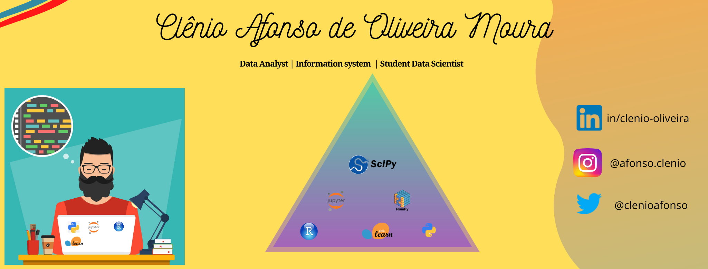
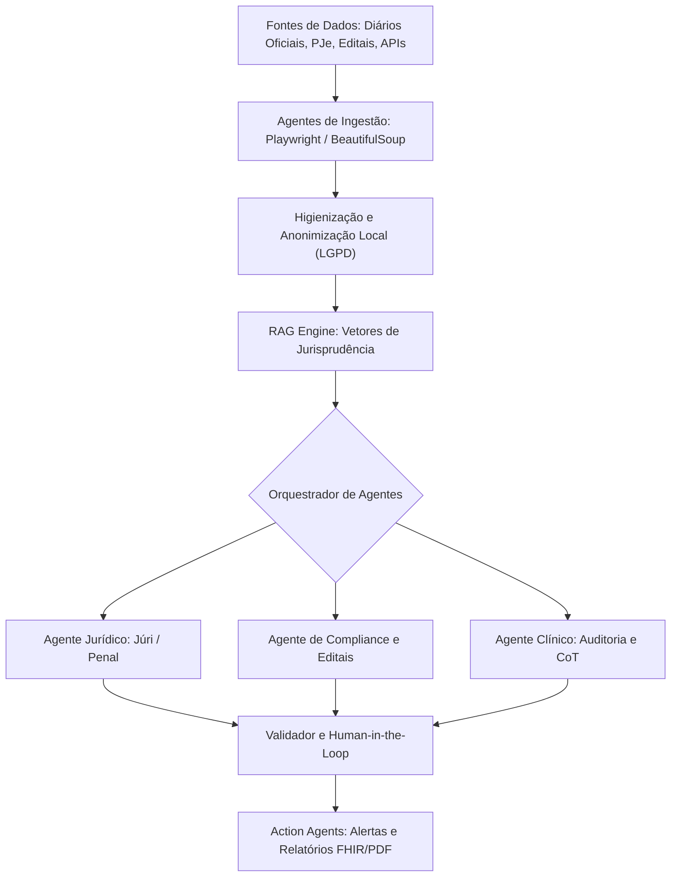
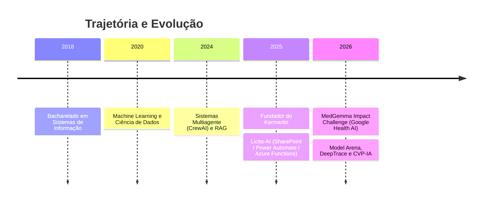

  

<h1 align="center">Clênio Oliveira</h1>

<b>AI Agent Engineer e fundador do Kermartin</b>: construo sistemas multiagente, RAG e SaaS para LegalTech, GovTech e HealthTech, do protótipo à produção.

Novo perfil: repositórios migrados de <a href="https://github.com/clenio77">@clenio77</a>.

---

## 🚀 Sobre

- 🔭 Fundador do [Kermartin](https://kermartin.ia.br), SaaS de análise jurídica com IA.
- 🎓 Bacharel em Sistemas de Informação (2018).
- 🤖 Orquestração multiagente (CrewAI), RAG, modelagem preditiva e Edge AI.
- 🛡️ Anonimização local sob a LGPD e auditoria de APIs.

---

## 🔨 Construindo agora

- 🏪 **Portal do comércio do Jardim Holanda** (Uberlândia): site estático em Astro alimentado por planilha, com coleta de dados em Python.
- 🛞 **Landing pages de alta conversão para Google Ads**, como a [Borracharia Bodoque](https://bodoqueborrachariamovel.vercel.app).
- 📖 **Leitor da Escrivaninha**: leitor de PDF em formato de livro, 100% no navegador e PWA.

Repositórios privados; links apenas para o que está no ar.

---

## 🤖 Arquitetura de Agentes Inteligentes

---

## 🏆 Projetos em Destaque

<table>
<tr>
<td width="50%" valign="top">

### ⚖️ [Kermartin IA](https://kermartin.ia.br)
SaaS de análise jurídica com IA para escritórios brasileiros: Tribunal do Júri e fluxos B2B multimódulo. 
**Stack:** Python · Django · React · Celery · CrewAI 
🌐 [kermartin.ia.br](https://kermartin.ia.br)

</td>
<td width="50%" valign="top">

### 🥊 [Model Arena](https://github.com/cleniooliveiramoura/model-arena)
Federação de sandboxes para comparar modelos e agentes com scoring blindado, scorecard capacidade × segurança e discussão agentic entre modelos. 
**Stack:** Python

</td>
</tr>
<tr>
<td width="50%" valign="top">

### 🔍 [DeepTrace](https://github.com/cleniooliveiramoura/deep-trace)
 
Web app + extensão Chrome de fact-checking de vídeos contra desinformação, com Google Gemini multimodal. 
**Stack:** JavaScript · Gemini 
🌐 [deep-trace-analysis.vercel.app](https://deep-trace-analysis.vercel.app)

</td>
<td width="50%" valign="top">

### 🎵 [SonicStream](https://github.com/cleniooliveiramoura/sonicStream)
Extrator de áudio (MP3) e vídeo (MP4) self-hosted, com fila em threads e PWA responsivo. 
**Stack:** Python · FastAPI · yt-dlp · FFmpeg · Docker

</td>
</tr>
<tr>
<td width="50%" valign="top">

### 🛡️ [MedGemma Guardian](https://github.com/cleniooliveiramoura/MedGemma-Guardian)
Agente de suporte à decisão clínica e auditoria de prescrições, com privacidade local (Kaggle MedGemma Impact Challenge). 
**Stack:** Python · MedGemma · FastAPI · FHIR

</td>
<td width="50%" valign="top">

### ⛪ [Liturgia Isaías — Caderno da Missa](https://liturgia-isaias.vercel.app)
Repertório litúrgico digital com letras e cifras para as missas. 
**Stack:** Next.js · TypeScript · Tailwind · PWA 
🌐 [liturgia-isaias.vercel.app](https://liturgia-isaias.vercel.app)

</td>
</tr>
<tr>
<td width="50%" valign="top">

### 💬 [KoTauri](https://github.com/cleniooliveiramoura/clenio-kotauri)
Cliente desktop leve para Telegram (Tauri 2 + Telegram Web K) e shell PWA para celular. 
**Stack:** Rust · Tauri 2 · PWA

</td>
</tr>
</table>

---

## 📂 Outros Projetos

**⚖️ GovTech & LegalTech:** CVP-IA (auditoria de gastos parlamentares) · Licita-AI (licitações no Microsoft 365) 
**📱 Apps e SaaS:** Agenda Clinical (SaaS para psicólogos) · Carteira Inteligente (investimentos com IA) · RotaFácil (rotas de entrega) 
**⛪ Igreja e comunidade:** [Capelania Jesus Bom Pastor](https://capelania.vercel.app) · Ministério Isaías

Repositórios privados; os links levam aos sites no ar.

---

## 🛠️ Stack Tecnológica

**IA & Orquestração** 

**Linguagens** 

**Backend & Dados** 

**Frontend & Apps** 

**Automação & Infra** 

---

## 💼 Linha do Tempo

---

## 📊 Estatísticas do GitHub

  
  

  

