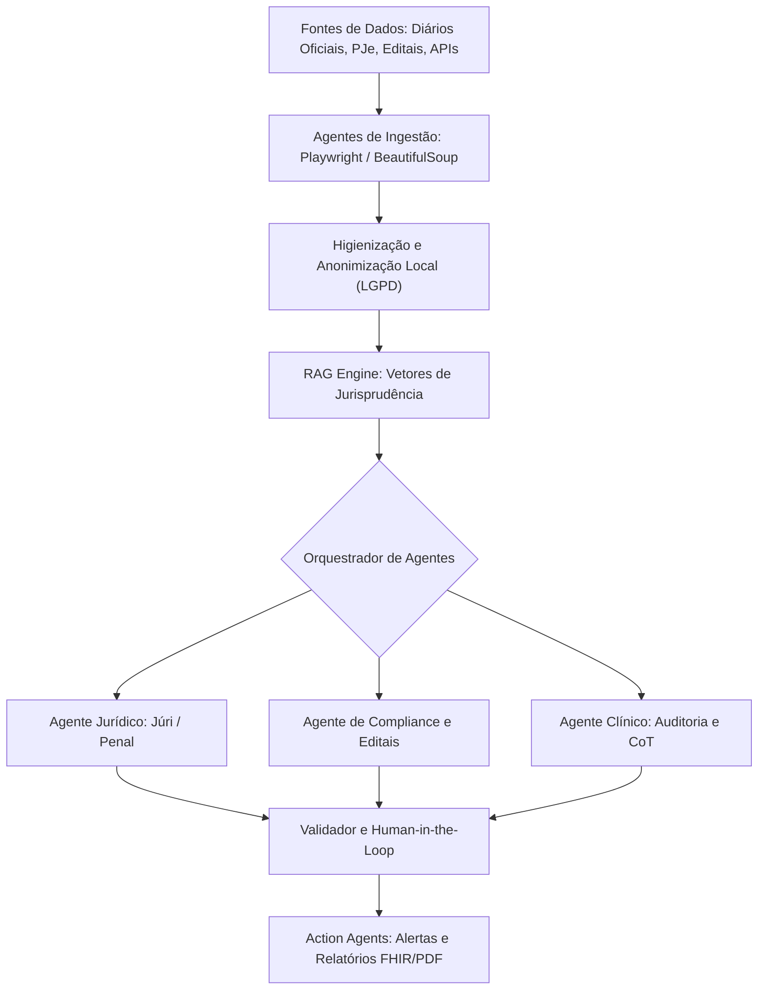
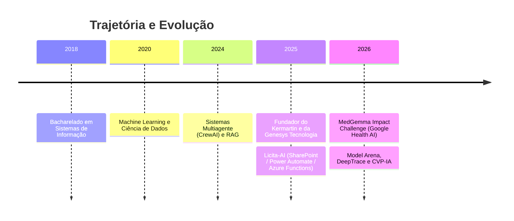

  

<h1 align="center">
  
</h1>

> ℹ️ Este é meu novo perfil. Meus repositórios foram migrados de [@clenio77](https://github.com/clenio77).

---

## 🚀 Perfil Profissional

**AI Agent Engineer | Arquiteto de Sistemas SaaS | Cientista de Dados**

Especializado no desenvolvimento de ecossistemas inteligentes corporativos e soluções completas ponta a ponta (SaaS). Atuo com foco em modelagem preditiva, engenharia de prompts avançada (Chain-of-Thought) e orquestração de sistemas multiagente autônomos para setores regulados de alta complexidade, como **LegalTech**, **GovTech** e **HealthTech**.

- 🔭 **Fundador**: [Kermartin](https://kermartin.ia.br) (SaaS de análise jurídica com IA) e [Genesys Tecnologia](https://genesys.ia.br) (consultoria que implanta e opera o Kermartin).
- 🎓 **Formação**: Bacharel em Sistemas de Informação (2018).
- 🤖 **Especialidades em IA**: Orquestração Multiagente (CrewAI), RAG, Modelagem Preditiva e Edge AI para processamento local de dados clínicos.
- 🛡️ **Segurança e Conformidade**: Pipelines locais de anonimização sob a LGPD e auditoria de APIs.

---

## 🤖 Arquitetura de Agentes Inteligentes

---

## 🏆 Projetos em Destaque

<table>
<tr>
<td width="50%" valign="top">

### ⚖️ [Kermartin IA](https://github.com/cleniooliveiramoura/kermartin)
SaaS de análise jurídica com IA para escritórios brasileiros: Tribunal do Júri e fluxos B2B multimódulo. 
**Stack:** Python · Django · React · Celery · CrewAI 
🌐 [kermartin.ia.br](https://kermartin.ia.br)

</td>
<td width="50%" valign="top">

### 🥊 [Model Arena](https://github.com/cleniooliveiramoura/model-arena)
Federação de sandboxes para comparar modelos e agentes com scoring blindado, scorecard capacidade × segurança e discussão agentic entre modelos. 
**Stack:** Python

</td>
</tr>
<tr>
<td width="50%" valign="top">

### 🔍 [DeepTrace](https://github.com/cleniooliveiramoura/deep-trace)
Web app + extensão Chrome de fact-checking de vídeos contra desinformação, com Google Gemini multimodal. 
**Stack:** JavaScript · Gemini 
🌐 [deep-trace-analysis.vercel.app](https://deep-trace-analysis.vercel.app)

</td>
<td width="50%" valign="top">

### 🏛️ [CVP-IA — Painel Parlamentar](https://github.com/cleniooliveiramoura/painel-de-gastos-de-parlamentares)
Consulta e auditoria de gastos, votações, proposições e alertas de parlamentares da Câmara e do Senado. 
**Stack:** JavaScript · Supabase · PWA

</td>
</tr>
<tr>
<td width="50%" valign="top">

### 🛡️ [MedGemma Guardian](https://github.com/cleniooliveiramoura/MedGemma-Guardian)
Agente de suporte à decisão clínica e auditoria de prescrições, com privacidade local (Kaggle MedGemma Impact Challenge). 
**Stack:** Python · MedGemma · FastAPI · FHIR

</td>
<td width="50%" valign="top">

### 🎵 [Liturgia Isaías — Caderno da Missa](https://github.com/cleniooliveiramoura/liturgia-isaias)
Repertório litúrgico digital com letras e cifras para as missas. 
**Stack:** Next.js · TypeScript · Tailwind · PWA 
🌐 [liturgia-isaias.vercel.app](https://liturgia-isaias.vercel.app)

</td>
</tr>
<tr>
<td width="50%" valign="top">

### ✍️ [ContentOS](https://github.com/cleniooliveiramoura/ContentOS)
Sistema operacional editorial AI-native para produção de conteúdo técnico, integrado a pipelines como o [YouTube Lo-Fi Workflow](https://github.com/cleniooliveiramoura/youtube-lofi-workflow). 
**Stack:** Specs em Markdown · agentes no Cursor · Python

</td>
<td width="50%" valign="top">

### 💬 [KoTauri](https://github.com/cleniooliveiramoura/clenio-kotauri)
Cliente desktop leve para Telegram (Tauri 2 + Telegram Web K) e shell PWA para celular. 
**Stack:** Rust · Tauri 2 · PWA

</td>
</tr>
</table>

---

## 📂 Outros Projetos

**🤖 IA, agentes e automação** —
[ClenioClaw](https://github.com/cleniooliveiramoura/clenioclaw) (assistente pessoal no Telegram) ·
[Hermes](https://github.com/cleniooliveiramoura/hermes) (config do Hermes Agent) ·
[Mentor de Concursos](https://github.com/cleniooliveiramoura/agente_concurseiro) ·
[Agente Social Media](https://github.com/cleniooliveiramoura/agente_social_media) ·
[SocialBot](https://github.com/cleniooliveiramoura/socialbot) ·
[Agente Autônomo](https://github.com/cleniooliveiramoura/agente-autonomo)

**⚖️ LegalTech & GovTech** —
[Genesys](https://github.com/cleniooliveiramoura/genesys) (site e docs da Genesys Tecnologia) ·
[Licita-AI](https://github.com/cleniooliveiramoura/licita-ai) (licitações no Microsoft 365 / Power Platform / Azure Functions) ·
[Licitação AI](https://github.com/cleniooliveiramoura/licitacao-ai) ·
[Advocacia AI](https://github.com/cleniooliveiramoura/escritorio-ai-advocacia)

**📱 Apps, SaaS e ferramentas** —
[Agenda Clinical](https://github.com/cleniooliveiramoura/pscologo-ai) (SaaS para psicólogos) ·
[Carteira Inteligente](https://github.com/cleniooliveiramoura/carteira-inteligente) (investimentos com IA) ·
[Gestor Financeiro](https://github.com/cleniooliveiramoura/gestor-financeiro) ·
[RotaFácil](https://github.com/cleniooliveiramoura/rota-facil) (rotas de entrega) ·
[Fênix PDF](https://github.com/cleniooliveiramoura/Fenix-PDF) ·
[Leitor da Escrivaninha](https://github.com/cleniooliveiramoura/leitor-pdf-livro) (PDF como livro) ·
[SonicStream](https://github.com/cleniooliveiramoura/sonicStream) (extrator de áudio/vídeo PWA) ·
[Portal Jardim Holanda](https://github.com/cleniooliveiramoura/portal-jardim-holanda) (comércio do bairro)

**🌐 Sites para clientes** —
[Borracharia Bodoque](https://github.com/cleniooliveiramoura/bodoqueborrachariamovel) ([no ar](https://bodoqueborrachariamovel.vercel.app)) ·
[Cerimonial Helton Oliveira](https://github.com/cleniooliveiramoura/cerimonial)

**⛪ Igreja e liturgia** —
[Capelania Jesus Bom Pastor](https://github.com/cleniooliveiramoura/capelania) ([no ar](https://capelania.vercel.app)) ·
[Ministério Isaías](https://github.com/cleniooliveiramoura/ministerioisaias) ·
[Comunidade Santo Expedito](https://github.com/cleniooliveiramoura/santoexpedito) ·
[Acalanto Sagrado](https://github.com/cleniooliveiramoura/acalanto-sagrado-legal)

**📊 Ciência de dados e estudos** —
[RiskRating](https://github.com/cleniooliveiramoura/RiskRating) ·
[Recomendação de Filmes](https://github.com/cleniooliveiramoura/movies_recomendation_system) ·
[Prever Salário](https://github.com/cleniooliveiramoura/Prever_salario) ·
[KC House](https://github.com/cleniooliveiramoura/kc_house) ·
[Data Science em Produção](https://github.com/cleniooliveiramoura/DataScienceEmProducao) ·
[Educação Financeira com IA](https://github.com/cleniooliveiramoura/educacao-financeira) ·
[Bootcamp Bradesco GenAI](https://github.com/cleniooliveiramoura/bootcamp-bradesco-dio-genai-dados-cyber) ·
[Seja Data Science](https://github.com/cleniooliveiramoura/sejadatascience)

---

## 🛠️ Stack Tecnológica

**IA & Orquestração** 

**Linguagens** 

**Backend & Dados** 

**Frontend & Apps** 

**Automação & Infra** 

---

## 💼 Linha do Tempo

---

## 📊 Estatísticas do GitHub

  
  

  

